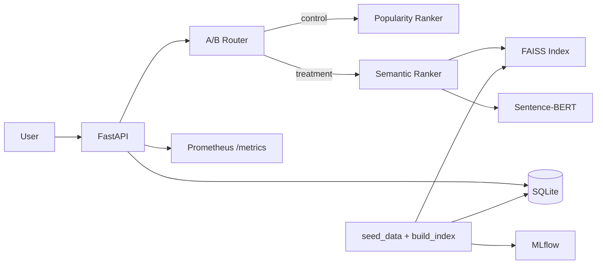

# Junior Job Recommender

Pet-project для вакансии **Junior ML Engineer @ Young&Junior**: рекомендации вакансий для джунов, семантический поиск, A/B-тесты и мониторинг моделей в проде.

## Что внутри

| Блок | Реализация |
|------|------------|
| Рекомендации | Popularity (control) vs semantic matching по резюме (treatment) |
| NLP | Sentence-BERT (`paraphrase-multilingual-MiniLM-L12-v2`) |
| Поиск | FAISS (cosine via inner product на нормализованных эмбеддингах) |
| Прод | FastAPI + Docker |
| Данные | SQLAlchemy + SQLite, pandas-friendly схема |
| A/B | Детерминированный сплит по `user_id`, метрика CTR |
| Мониторинг | Prometheus metrics (`/metrics`) |
| Эксперименты | MLflow при сборке индекса |

## Архитектура



## Быстрый старт

```bash
python -m venv .venv
.venv\Scripts\activate        # Windows
pip install -r requirements.txt

python scripts/seed_data.py
python scripts/build_index.py
uvicorn app.main:app --reload
```

API: http://127.0.0.1:8000/docs

### Docker

```bash
docker compose up --build
```

## API

| Метод | Endpoint | Описание |
|-------|----------|----------|
| GET | `/users/{id}/recommendations` | Персональные рекомендации + A/B-вариант |
| POST | `/search` | Семантический поиск по запросу |
| POST | `/events` | Клики / дополнительные события |
| GET | `/ab/stats` | CTR по вариантам эксперимента |
| GET | `/metrics` | Prometheus-метрики |
| GET | `/jobs` | Список вакансий |

### Пример

```bash
curl "http://127.0.0.1:8000/users/1/recommendations?top_k=5"

curl -X POST "http://127.0.0.1:8000/search" \
  -H "Content-Type: application/json" \
  -d "{\"query\": \"junior python fastapi\", \"top_k\": 5}"
```

Симуляция трафика для A/B:

```bash
python scripts/simulate_ab.py
```

## A/B-эксперимент

- **Control** — ранжирование по популярности (`applications`, `views`)
- **Treatment** — семантическое сходство профиля пользователя с вакансией
- Сплит: `md5(user_id)` → bucket, доля control настраивается через `AB_CONTROL_RATIO`
- Метрика: **CTR** = clicks / impressions

## Стек

Python, pandas, numpy, scikit-learn, sentence-transformers, PyTorch, FAISS, FastAPI, SQLAlchemy, Docker, MLflow, Prometheus

## Тесты

```bash
pytest -q
```

## Структура

```
app/
  api/          # FastAPI routes
  db/           # SQL models + repository
  ml/           # embeddings, FAISS, recommender
  ab/           # experiment assignment + analysis
  monitoring/   # Prometheus metrics
scripts/
  seed_data.py
  build_index.py
  simulate_ab.py
tests/
```

## Почему это релевантно Young&Junior

Проект моделирует ключевые задачи платформы: агрегация вакансий → персональные рекомендации → измерение конверсии в продукте. Код небольшой, но покрывает полный цикл product ML: данные → модель → API → эксперимент → мониторинг.

---

*Pet-project для демонстрации навыков. Не аффилирован с Young&Junior.*
